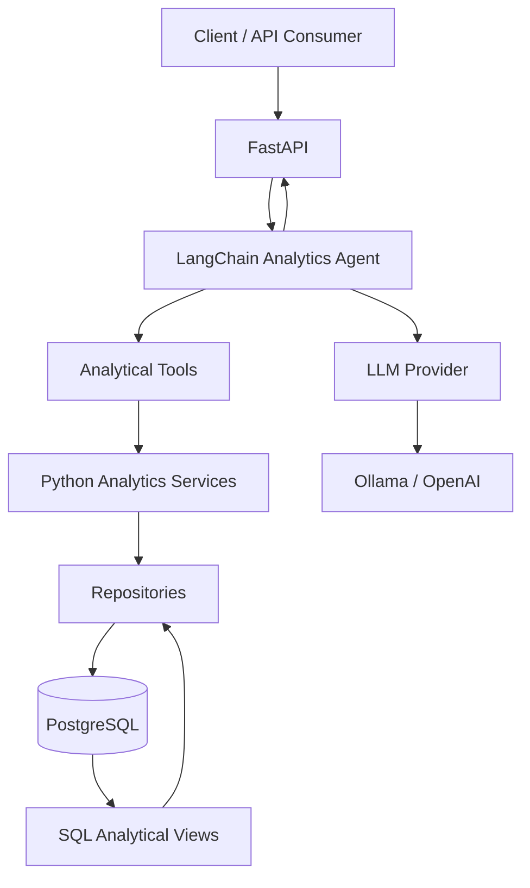

# Healthcare Intelligence Copilot

**An AI-powered analytical assistant for healthcare financial and operational intelligence.**

Healthcare Intelligence Copilot is a data-driven AI application designed to support analytical decision-making in healthcare organizations. It combines deterministic SQL analytics, Python services, LLM-powered reasoning, and an API layer to transform structured healthcare data into actionable business insights.

The project follows a core architectural principle: **financial calculations and business metrics are computed by deterministic analytical services, never generated by the LLM.** The language model orchestrates analytical tools and communicates their results in natural language.

## Architecture



### Architectural principles

- **Deterministic analytics:** SQL and Python handle financial calculations, aggregations, rankings, and business rules.
- **Tool-based reasoning:** The agent selects specialized analytical tools to answer business questions.
- **LLM flexibility:** Supports configurable model providers, including Ollama and OpenAI.
- **Separation of concerns:** API, agent orchestration, analytics services, repositories, and database layers have distinct responsibilities.
- **Data integrity:** Analytical results originate from structured database queries rather than model-generated estimates.

## Technology Stack

| Layer | Technologies |
|---|---|
| Language | Python 3.12+ |
| API | FastAPI, Uvicorn |
| AI orchestration | LangChain, LangGraph |
| LLM providers | Ollama, OpenAI |
| Data processing | Pandas, NumPy |
| Database | PostgreSQL |
| Vector database support | pgvector |
| ORM / SQL | SQLAlchemy, Psycopg |
| Data science | Scikit-learn, Statsmodels |
| Configuration | Pydantic Settings, python-dotenv |
| Testing | Pytest, HTTPX |
| Code quality | Ruff |
| Environment and dependency management | uv |

## Current Capabilities

- Financial analytics for healthcare operations.
- Monthly revenue and healthcare expenditure analysis.
- Presented versus paid expenditure analysis.
- Claims ratio analytical views.
- Provider, procedure, and contract expenditure rankings.
- Individual and combined participation calculations.
- LLM-powered natural language interaction with analytical tools.
- REST API for analytical queries.
- Interactive API documentation through Swagger UI.
- Unit and integration testing.

## Data Model

The analytical database uses a dimensional model with the following entities:

- `dim_tempo`
- `dim_beneficiario`
- `dim_prestador`
- `dim_procedimento`
- `dim_contrato`
- `fato_receita`
- `fato_despesa_assistencial`

The project uses synthetic data for development and demonstration purposes.

No real patient or beneficiary data is required.

## Project Structure

```text
healthcare-intelligence-copilot/
├── app/
│   ├── agents/
│   ├── analytics/
│   │   └── services/
│   ├── api/
│   │   └── routes/
│   ├── database/
│   │   └── repositories/
│   ├── graph/
│   ├── llm/
│   └── rag/
├── database/
│   └── sql/
├── docs/
├── tests/
│   ├── integration/
│   └── unit/
├── .env.example
├── .gitignore
├── docker-compose.yml
├── pyproject.toml
├── uv.lock
└── README.md
```

## Getting Started

### Prerequisites

- Python 3.12+
- Docker Desktop
- uv
- Ollama or an OpenAI API key

### 1. Clone the repository

```bash
git clone https://github.com/TiagoSaucedo/healthcare-intelligence-copilot.git
cd healthcare-intelligence-copilot
```

### 2. Configure environment variables

```bash
copy .env.example .env
```

Update the environment variables according to your local configuration.

Never commit `.env` or real credentials.

### 3. Install dependencies

```bash
uv sync
```

### 4. Start PostgreSQL

```bash
docker compose up -d
```

### 5. Initialize the database

Execute the SQL scripts in `database/sql/` in numerical order and run the synthetic data seed scripts as required by the application.

### 6. Start the API

```bash
uv run uvicorn app.api.main:app --reload
```

The API will be available at:

`http://127.0.0.1:8000`

### 7. Explore the API

- Health check: `http://127.0.0.1:8000/health`
- Swagger UI: `http://127.0.0.1:8000/docs`

## Example Analytical Query

Example request:

```http
POST /api/v1/chat
Content-Type: application/json
```

```json
{
  "message": "Which healthcare providers had the highest presented expenses in 2028?"
}
```

The agent identifies the analytical requirement, invokes the appropriate tool, retrieves deterministic results, and returns a natural language explanation.

## Testing

Run the complete test suite:

```bash
uv run python -m pytest -v
```

Run API integration tests:

```bash
uv run python -m pytest tests/integration/test_api.py -v
```

## Engineering Decisions

### Why deterministic analytics instead of LLM-generated calculations?

Financial and operational decisions require traceability, consistency, and reproducibility.

For this reason:

1. SQL performs data aggregation.
2. Python services implement analytical calculations and business rules.
3. LangChain tools expose these operations to the agent.
4. The LLM interprets and communicates the returned results.

This approach reduces numerical hallucinations and makes analytical outputs easier to validate.

## Roadmap

- [x] Dimensional database model.
- [x] Synthetic healthcare data generation.
- [x] SQL analytical views.
- [x] Python analytics services.
- [x] LangChain analytical tools.
- [x] LLM provider abstraction.
- [x] FastAPI integration.
- [x] Unit and integration tests.
- [ ] Production-grade frontend.
- [ ] Advanced LangGraph workflows.
- [ ] Retrieval-Augmented Generation (RAG).
- [ ] Automated CI pipeline.
- [ ] Authentication, authorization, and observability enhancements.

## Disclaimer

This project is an engineering and portfolio initiative using synthetic healthcare data. It is not intended for clinical diagnosis or direct medical decision-making.

## Author

**Tiago Saucedo**

Data Scientist | Python | Machine Learning | AI Engineering

[GitHub](https://github.com/TiagoSaucedo)