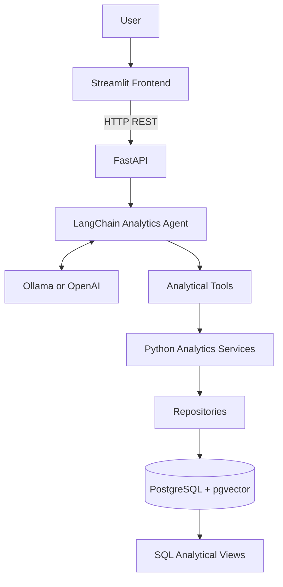

# Healthcare Intelligence Copilot

An AI-powered analytical assistant for healthcare financial and operational intelligence.

The Healthcare Intelligence Copilot combines deterministic SQL and Python analytics with an LLM-powered conversational interface. It allows users to explore financial and operational indicators through interactive dashboards and natural-language questions.

The project was developed as a professional data science and AI portfolio project, using synthetic healthcare data.

## Key Principles

- **Deterministic analytics:** SQL and Python services are responsible for all metrics, aggregations, rankings, and calculations.
- **LLM as an orchestrator:** The language model interprets questions, selects analytical tools, and communicates their results.
- **Separation of concerns:** The frontend communicates with the backend through REST endpoints.
- **Data integrity:** Business rules and metric definitions remain in the analytical layer.
- **Flexible LLM provider:** Supports local inference with Ollama or API-based inference with OpenAI.

## Architecture



The agent is implemented using LangChain's `create_agent` API, which relies on the LangGraph runtime for agent and tool orchestration. The project does not currently implement a custom manually defined LangGraph workflow.

The Streamlit frontend communicates exclusively with the FastAPI backend. It does not access the database directly.

## Features

### Interactive dashboards

- Financial overview and monthly trends.
- Revenue by competence.
- Presented and paid healthcare expenses.
- Expense-to-revenue relationship indicators.
- Provider analytics.
- Procedure analytics.
- Contract analytics.
- Analytical rankings by provider, procedure, and contract.
- Ranking concentration and participation indicators.

### Conversational AI

- Natural-language questions in Portuguese.
- Analytical tool selection through a LangChain agent.
- Deterministic backend calculations.
- Responses based on retrieved analytical results.
- Ollama and OpenAI provider support.

### REST API

- FastAPI backend.
- Health-check endpoint.
- Financial, provider, procedure, and contract analytics.
- Ranking endpoints.
- Conversational endpoint.
- Interactive API documentation through Swagger UI.

## Technology Stack

| Area | Technologies |
|---|---|
| Language | Python 3.12+ |
| Backend | FastAPI, Uvicorn |
| Frontend | Streamlit |
| Agent orchestration | LangChain, LangGraph runtime |
| LLM providers | Ollama, OpenAI |
| Data processing | Pandas, NumPy |
| Database | PostgreSQL 17, pgvector |
| Database access | SQLAlchemy, Psycopg |
| Data science | Scikit-learn, Statsmodels |
| Configuration | Pydantic Settings, python-dotenv |
| Testing | Pytest, HTTPX |
| Code quality | Ruff |
| Environment management | uv |
| Infrastructure | Docker Desktop, Docker Compose |

## Data Model

The project uses a synthetic dimensional data model containing:

- Beneficiaries, including historical versions.
- Healthcare contracts.
- Healthcare providers.
- Medical procedures.
- Time dimension.
- Revenue fact records.
- Healthcare expense fact records.

The analytical layer distinguishes between:

- Revenue recognized by competence.
- Presented expenses associated with healthcare services.
- Paid expenses associated with payment dates.

These definitions are important because the different measures do not necessarily share the same reference month.

## Project Structure

```text
healthcare-intelligence-copilot/
├── app/
│   ├── agents/
│   ├── analytics/
│   │   └── services/
│   ├── api/
│   │   └── routes/
│   ├── database/
│   │   └── repositories/
│   ├── frontend/
│   │   ├── api_client.py
│   │   └── streamlit_app.py
│   ├── graph/
│   └── llm/
├── database/
│   └── sql/
├── tests/
├── .env.example
├── .gitignore
├── .python-version
├── docker-compose.yml
├── pyproject.toml
├── uv.lock
└── README.md
```

## Getting Started

### Prerequisites

Install the following tools:

- Python 3.12 or later.
- [uv](https://docs.astral.sh/uv/).
- [Docker Desktop](https://www.docker.com/products/docker-desktop/).
- [Ollama](https://ollama.com/) for local LLM inference, or an OpenAI API key.

Optional:

- [DBeaver Community](https://dbeaver.io/download/) for visual database inspection and SQL validation.

### 1. Clone the repository

```powershell
git clone https://github.com/TiagoSaucedo/healthcare-intelligence-copilot.git

cd healthcare-intelligence-copilot
```

### 2. Configure environment variables

```powershell
Copy-Item .env.example .env
```

Edit `.env` and configure the database and LLM provider.

The example configuration uses Ollama. For OpenAI, configure the API key and select the corresponding provider.

Do not commit the `.env` file or expose credentials.

### 3. Install Python dependencies

```powershell
uv sync
```

### 4. Start PostgreSQL with pgvector

Make sure Docker Desktop is running.

```powershell
docker compose up -d
```

Check the container:

```powershell
docker ps
```

The PostgreSQL service uses the `pgvector/pgvector:pg17` image.

### 5. Initialize the database

Run the following commands from the project root in PowerShell.

First, define a helper function to execute SQL files inside the PostgreSQL container:

```powershell
function Invoke-SqlFile {
    param([string]$File)

    Get-Content $File -Raw |
        docker exec -i healthcare-postgres psql `
            -U healthcare_user `
            -d healthcare_intelligence `
            -v ON_ERROR_STOP=1

    if ($LASTEXITCODE -ne 0) {
        throw "SQL execution failed: $File"
    }
}
```

Execute the schema and initial migrations:

```powershell
Invoke-SqlFile "database/sql/001_create_schema.sql"
Invoke-SqlFile "database/sql/002_adjust_beneficiario_scd2.sql"
Invoke-SqlFile "database/sql/002_populate_dim_tempo.sql"
```

Load the dimension data:

```powershell
uv run python -m app.database.seed_beneficiarios
uv run python -m app.database.seed_contratos
uv run python -m app.database.seed_prestadores
uv run python -m app.database.seed_procedimentos
```

Load the fact data:

```powershell
uv run python -m app.database.seed_receitas
uv run python -m app.database.seed_despesas
```

Create the analytical views and apply the remaining migrations in dependency order:

```powershell
Invoke-SqlFile "database/sql/003_create_analytical_views.sql"
Invoke-SqlFile "database/sql/004_create_monthly_overview.sql"
Invoke-SqlFile "database/sql/005_create_claims_ratio_views.sql"
Invoke-SqlFile "database/sql/006_create_care_analytics_views.sql"
Invoke-SqlFile "database/sql/007_add_contract_to_expenses.sql"
Invoke-SqlFile "database/sql/008_create_contract_analytics_view.sql"
Invoke-SqlFile "database/sql/009_create_analytical_rankings.sql"
Invoke-SqlFile "database/sql/010_rebuild_analytical_rankings.sql"
Invoke-SqlFile "database/sql/011_create_paid_expenses_by_provider.sql"
```

The order matters because some migrations depend on previously created tables, populated facts, or analytical views.

The database initialization sequence above is intended for a fresh database. Do not rerun the schema creation and seed commands against an existing populated database without checking their effects first.

### 6. Configure the LLM

For local inference, install Ollama and download the model configured in `.env`.

Example:

```powershell
ollama pull llama3.1:8b
```

Make sure the Ollama service is running.

Alternatively, configure the OpenAI provider and its API key in `.env`.

### 7. Start the backend

Open a PowerShell terminal:

```powershell
uv run uvicorn app.api.main:app --reload
```

The API will be available at:

```text
http://localhost:8000
```

Swagger documentation:

```text
http://localhost:8000/docs
```

### 8. Start the Streamlit frontend

Open a second PowerShell terminal:

```powershell
uv run python -m streamlit run app\frontend\streamlit_app.py
```

The application will be available at:

```text
http://localhost:8501
```

Keep both terminal sessions running while using the application.

## Example API Request

The conversational endpoint is:

```http
POST /api/v1/chat
```

Example request:

```json
{
  "message": "Quais foram os cinco prestadores com maior despesa paga em outubro de 2028?"
}
```

The agent selects the appropriate analytical tool. The backend retrieves and calculates the results, and the LLM formats the response.

## Testing and Code Quality

Run the test suite:

```powershell
uv run pytest -v
```

Run lint checks:

```powershell
uv run ruff check .
```

The project has reached **194 passing automated tests** in its recorded validation, covering analytical services, API behavior, and other application components.

## Database Inspection

DBeaver Community can optionally be used to connect to the PostgreSQL container and inspect:

- Dimension and fact tables.
- SQL analytical views.
- Monthly aggregations.
- Provider, procedure, and contract rankings.
- Query results used to validate the application.

The application does not depend on DBeaver. Database initialization and application execution can be performed entirely through the terminal.

## Engineering Decisions

### Deterministic analytics and LLM separation

The LLM does not independently calculate financial indicators or invent analytical results.

Instead, it uses predefined tools that call Python services and database repositories. This approach improves reproducibility, testability, and consistency of business rules.

### Flexible model provider

The application supports local inference through Ollama and API-based inference through OpenAI, allowing the model provider to be changed through configuration.

### Synthetic data

All data used in this portfolio project is synthetic and intended for demonstration and development purposes. No real patient information is used.

## Disclaimer

This project is a portfolio and engineering initiative built with synthetic healthcare data. It is intended for analytical demonstration and does not provide clinical diagnoses or support direct medical decision-making.

## Roadmap

- [x] Dimensional data model and PostgreSQL setup.
- [x] SQL analytical views.
- [x] Python analytical services and repositories.
- [x] Financial, provider, procedure, and contract analytics.
- [x] Analytical rankings.
- [x] LangChain agent and analytical tools.
- [x] FastAPI REST backend.
- [x] Streamlit interactive dashboard.
- [x] Natural-language analytical assistant.
- [x] Automated tests and lint validation.
- [ ] Advanced custom LangGraph workflows.
- [ ] Retrieval-Augmented Generation (RAG).
- [ ] Continuous integration pipeline.
- [ ] Authentication and production observability.

## Author

**Tiago Saucedo**

Data Scientist | Python | R | Spark | Machine Learning

[LinkedIn](https://www.linkedin.com/in/tiago-saucedo/)

[GitHub](https://github.com/TiagoSaucedo)
